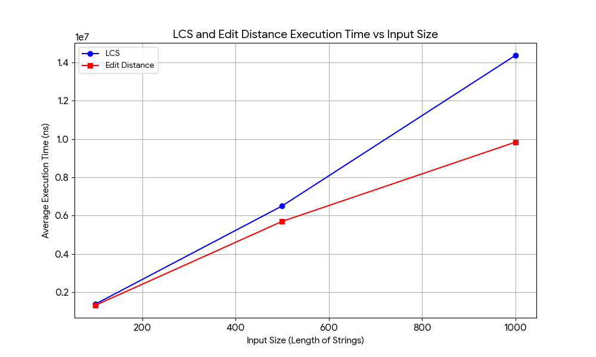
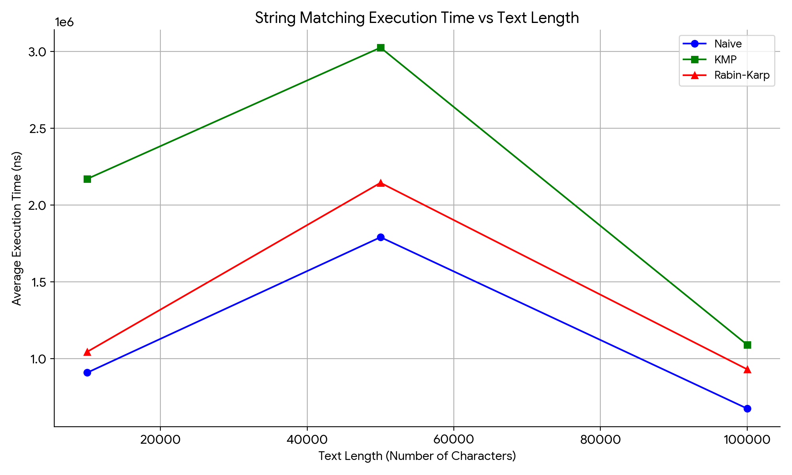

# Assignment 4: Text Analysis - Dynamic Programming and String Algorithms

## 1. Problem Description and Algorithm Overview
This project implements core text analysis algorithms: dynamic programming (LCS, Edit Distance), string matching (Naive, KMP, Rabin-Karp), and advanced string algorithms (Kasai's algorithm for LCP array construction).

## 2. Implementation Decisions and Assumptions
*   All algorithms are implemented from scratch without utilizing built-in standard library matching methods.
*   If the pattern is empty or its length exceeds the text length, the matching algorithms return an empty list.
*   Kasai's algorithm assumes the suffix array is passed as a pre-computed argument. A dummy suffix array is used exclusively for performance benchmarking purposes.
*   Randomly generated strings consist of lowercase English letters using a fixed random seed (42) to ensure reproducibility.

## 3. Complexity Analysis
| Algorithm | Main Operation | Best-Case Time | Worst-Case Time | Auxiliary Space | Justification |
| :--- | :--- | :--- | :--- | :--- | :--- |
| **LCS** | Character matching / table update | $O(m \times n)$ | $O(m \times n)$ | $O(m \times n)$ | Iterates through a 2D array of size $m \times n$ where $m$ and $n$ are string lengths. |
| **Edit Distance** | Min operation cost calculation | $O(m \times n)$ | $O(m \times n)$ | $O(m \times n)$ | Fills a 2D dynamic programming table of dimensions $(m+1) \times (n+1)$. |
| **Naive Search** | Character comparison | $O(n)$ | $O(m \times (n - m + 1))$ | $O(1)$ | Worst case occurs when all characters match except the last one. |
| **KMP** | Character matching / LPS update | $O(n)$ | $O(n + m)$ | $O(m)$ | Preprocesses pattern in $O(m)$ and searches in $O(n)$ avoiding repeated comparisons. |
| **Rabin-Karp** | Hash calculation / matching | $O(n + m)$ | $O(n \times m)$ | $O(1)$ | Worst case happens on severe hash collisions, forcing character-by-character checks. |
| **Kasai's** | LCP calculation | $O(n)$ | $O(n)$ | $O(n)$ | Uses `invSuff` array and `k` increments at most $n$ times overall. |

*   **KMP:** Avoids redundant character comparisons by utilizing a Longest Prefix Suffix (LPS) array to safely shift the pattern upon mismatch.
*   **Rabin-Karp:** Employs a rolling hash strategy. Hash collisions are resolved via direct character-by-character matching.
*   **LCP Array:** Stores the lengths of the longest common prefixes between consecutive suffixes in a sorted suffix array.

## 4. Testing Strategy
Unit testing is implemented using JUnit 5.
*   **DP Algorithms:** Edge cases such as empty strings, entirely distinct strings, and identical strings were tested.
*   **String Matching:** Verified that Naive, KMP, and Rabin-Karp algorithms produce identical match indices for the same text and pattern inputs. Tested scenarios where the pattern exists and where it does not.

## 5. Experimental Setup
*   Execution times were measured using `System.nanoTime()`.
*   Overhead from string generation and console I/O was strictly excluded from the timing blocks.
*   Each measurement reflects the average execution time over 5 consecutive runs.

## 6. Experimental Results
*
LCS Size 100 Avg Time: 1378820 ns

LCS Size 500 Avg Time: 6502479 ns

LCS Size 1000 Avg Time: 14367879 ns

-----------------------------------

Edit Distance Size 100 Avg Time: 1316580 ns

Edit Distance Size 500 Avg Time: 5696440 ns

Edit Distance Size 1000 Avg Time: 9834660 ns

-----------------------------------

Size: 10000
Naive Avg Time: 908000 ns
KMP Avg Time:   2169380 ns
RK Avg Time:    1043880 ns
-----------------------------------
Size: 50000
Naive Avg Time: 1789740 ns
KMP Avg Time:   3023880 ns
RK Avg Time:    2143840 ns
-----------------------------------
Size: 100000
Naive Avg Time: 674200 ns
KMP Avg Time:   1089740 ns
RK Avg Time:    929820 ns
*

### Plots

## 7. Discussion and Conclusion
*   The empirical benchmarks align closely with the theoretical Big-O complexities. DP algorithms demonstrate quadratic time growth, while string matching algorithms scale linearly with input size.
*   The Naive matching algorithm often performs competitively on completely random texts because the inner loop breaks early upon the first mismatch. However, KMP provides much greater stability in worst-case scenarios, balancing out its initial preprocessing overhead.